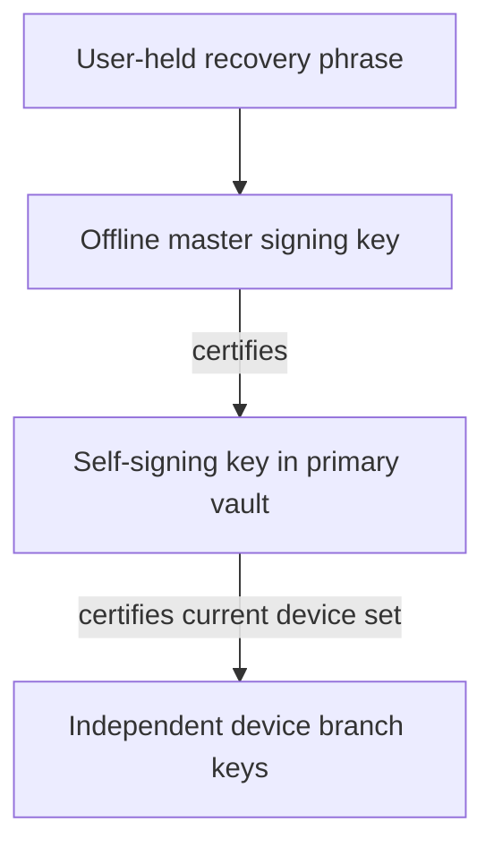

# Root key custody

Design revision 2, phase 1. This proposal changes no executable behavior. The
inspected product baseline is `eae12fbb197f8bbea21b682686c8548fc1a27958`.
Current accounts still keep the root seed on each device. Activation requires
coordinated protocol, verifier, vault, backup and client changes; the guarantees
below describe that future system, not an implemented or audited feature.

## Authority and recovery model

The user keeps one recovery artifact: a generated 24-word recovery phrase. Nodes
store no recovery secret, encrypted recovery capsule, phrase verifier or reset
credential. Normal public identity records and revocation state remain necessary
for authentication; they are not secret recovery storage.

Use three authority tiers:



The master is derived temporarily during setup or an explicit recovery/promotion
ceremony and erased from every device afterward. Only the primary holds the
self-signing private key. Every device holds its own independent branch secrets.
Normal primary operations use the self-signing key, not the offline master.
This adopts the master/self-signing separation from
[Matrix cross-signing](https://spec.matrix.org/latest/client-server-api/#cross-signing);
it does not adopt Matrix secret storage or add a user-signing key.

Lost or stolen primary: enter the phrase on a trusted replacement, certify a new
self-signing key, revoke the old one and retain the same identity. Compromise of
the phrase/master instead requires a new identity and contact re-verification.
A primary's ordinary data-unlock secret, vault credential or branch seed cannot
reconstruct the phrase or master. A backup password restores data, not authority.

If both primary and phrase are lost, identity management is permanently lost.
Surviving secondaries retain local history but stop new authenticated network
operations when their authorization leases expire. They can export data for a new
identity. If only the phrase is lost, the existing primary continues operating,
but cannot replace the offline master or recover from its own future loss; offer
migration to a new identity while it is still available. There is no support reset.

## Verified current implementation

These source facts were checked on the baseline above:

- [Account manifests](../crates/ramflux-sdk/src/bus/protocol.rs) persist
  `root_seed`, `device_seed` and `account_secret`.
  [Daemon startup](../crates/ramflux-sdk/src/bus/daemon.rs) reconstructs the root
  signer from the manifest, so deleting a field alone would break startup.
- [Owned authority](../crates/ramflux-sdk/src/client/identity_authority/owned.rs)
  signs root-bound branch proofs and complete device sets.
  [Registration refresh](../crates/ramflux-sdk/src/client/identity_authority/registration.rs)
  normally renews proofs with a one-hour lifetime. Secondaries currently need the
  root for this refresh even when device membership does not change.
- [Device-set types](../crates/ramflux-protocol/src/identity_keys.rs) preserve
  immutable principal kind and revocation tombstones. Device-set v2 incorporates
  the root-signed [public profile](identity_profiles.md); profile omission and
  downgrade floors already matter. This proposal extends that family to v3.
- [Legacy key backup](../crates/ramflux-sdk/src/bus/dispatch/account.rs) encrypts
  the whole account manifest. The streamed full archive's
  [identity metadata](../crates/ramflux-sdk/src/bus/backup_jobs/format.rs) also
  contains that manifest and a database key. Both currently include the root seed.
- [The recovery KDF](../crates/ramflux-crypto/src/kdf.rs) currently uses Argon2id
  v19 with 262144 KiB, three passes and one lane. That existing password-based
  behavior is not the proposed generated-phrase derivation below.
- Current root access also serves group actor/certificate and profile signing.
  Every such accessor needs an explicit authority capability; a missing secret
  must never trigger legacy seed copying or implicit account creation.

The separately developed
[creator snapshot protocol](https://github.com/ramfluxhq/ramflux/blob/0e769262faa869e00f46dfa9d95dd8e76f3d007d/docs/group_state.md)
uses creator authority plus authenticated branch transport. It needs a delegation
verification version before a creator secondary can discard its legacy root.

## Threat model

| Threat | Intended boundary and residual risk |
| --- | --- |
| Stolen/compromised secondary | It can read available history and act as its branch until revocation/lease enforcement. It cannot enroll, revoke, renew its own authority, become primary or recover the identity. A creator delegation can still expose future group traffic to attacker roots; see below. |
| Stolen/compromised primary | The self-signing key can enroll attacker devices and alter primary-authorized state until recovery reaches verifiers. It cannot certify a replacement master or escape its master-certified authority range. Data already read cannot be recovered by revocation. |
| Phrase phishing or capture | The attacker gains master authority. Clipboard history, screenshots, fake support and lookalike prompts are relevant. Unexpected master-authorized replacement is a new-identity incident. |
| Malware during a recovery ceremony | It may capture the temporarily derived master or phrase. The ceremony's OS and trusted UI are part of the trust boundary; routine primary isolation does not stop this attacker. |
| Malicious directory, gateway or relay | It cannot forge authority, approve pairing or decrypt a phrase that is never uploaded. It can withhold records, erasure acknowledgements or renewals and deny service. Signatures alone cannot prove a globally latest head. |
| Rollback, stale backup or old client | Custody-mode latches, one signed-record epoch floor, exact key bindings and revocation tombstones apply before authorization. Restore cannot lower these floors or restore a primary role. |
| Copied legacy root | Erasure cannot remove an attacker's copy. Migration cannot retroactively establish that a historical root was never compromised; an untrusted former holder requires a new identity. |

Every observing device records a prominent security alert for a primary-holder
or self-signing-key change, including a revoked old primary when it next obtains
the public update. Alerts identify the account fingerprint, old/new key
fingerprints and whether the device initiated the ceremony. They remain visible
until explicitly acknowledged; an offline or censored device cannot be promised
immediate delivery. Contact-facing security state should distinguish the same
identity's management-key replacement from a changed identity root.

The app never solicits the phrase in response to a network event, alert, login,
ordinary unlock or support request. Phrase entry exists only inside a locally
user-started recovery/primary-promotion ceremony, including an explicitly started
recovery dry run. Setup explains this rule. A periodic reminder asks whether the
user can still find their phrase; it never opens a phrase-entry form by itself.

## Phrase encoding and deterministic derivation

Generate 32 independent bytes with the operating-system CSPRNG. Encode them using
the English BIP39 wordlist and checksum: 256 entropy bits plus eight checksum bits
form 24 words. Decode back to the original entropy before derivation. This uses
[BIP39's entropy transcription](https://github.com/bitcoin/bips/blob/master/bip-0039.mediawiki),
not its wallet mnemonic-to-seed PBKDF2 function. Reject invalid word counts,
unknown words and checksum failures; never use a user-invented sentence.

Proposed profile `ramflux-recovery-v1`:

```text
entropy = decode_checked_24_words(phrase)       # exactly 32 bytes
master_seed = HKDF-SHA256(
    salt = 32 zero bytes,
    IKM = entropy,
    info = UTF8("ramflux.identity.master.v1"),
    L = 32)
master_public_key = Ed25519_public_key(master_seed)
```

The fixed public profile/domain means recovery needs no separate salt file,
capsule or password. [HKDF](https://www.rfc-editor.org/info/rfc5869/) supplies
explicit extract/expand domain separation; it is not a password-hardening scheme.
Generated entropy does not need Argon2id. Reserve a human-passphrase recovery
profile for separate review, including Argon2id parameters, normalization,
minimum-machine measurements and a versioned format. No automatic weaker fallback.
The existing account-data KDF is a separate compatibility concern, not changed
by this design note.

Setup is mandatory for new custody accounts before their first authority record
is published. Show the phrase once in a trusted screen and require the user to
re-enter a randomly selected subset from their saved copy. Publicly display the
resulting account fingerprint for confirmation. Explicit print/export is allowed;
warn that the exported phrase is identity authority. Export is a user-managed artifact, not
managed runtime state or an application backup; keeping it on the primary makes
a theft of that file a phrase-compromise incident. It never enters normal bus
responses, argv, environment, logs, analytics, crash dumps or sibling sync.

Zeroize entropy, phrase and master buffers on completion, cancellation and error;
avoid secret clones. Do not persist the master in a manifest, database, vault,
wrapped capsule or backup. A new phrase derives a new master: there is no
same-identity "rotate forgotten phrase" operation. Copies of the same user-held
phrase are the same authority, not revocable recovery credentials.

## One device-set v3 record and one floor

Extend the existing signed device-set/profile family. Device-set v3 carries the
immutable account anchor/kind, public master authorization, primary holder,
self-signing public key, complete device roster and tombstones, branch certificate
leases, custody mode, migration status and profile. Its signature is by the
master-certified self-signing key, under a new critical v3 domain. The master
certificate binds that key, account anchor, primary holder, authority scopes and
its permitted record-epoch range. No independent custody record or profile chain.

Profile kind remains immutable. Retain the existing normalized single-line name
rules and verified-kind semantics; neither a profile nor a custodian reference
proves biological humanity. The v3 profile's version is the enclosing record
epoch, including when a device/lease update leaves the visible name unchanged.
The primary alone publishes display-name changes; a secondary queues a request.
The v3 signature authenticates the entire embedded profile through the authority
chain. A v2 root signature must not be reinterpreted as a self-signing signature.
Workflow custody needs an explicitly supported v3 profile rather than silently
reusing v2's legacy workflow behavior.

**Counter-poisoning proposal for protocol review:** use one safe-JSON integer
epoch with master-allocated ranges. Reserve its high 21 bits for a master-certified
range and low 32 bits for primary revisions. A self-signing key cannot sign beyond
its assigned range. Master recovery advances to the next range even if a stolen
primary exhausted every revision in its old range. Verifiers persist one integer
floor and enforce the certificate's range before advancing it. Migration chooses
a range above retained epochs; exhaustion is a typed refusal, never wraparound.
The exact allocation needs protocol review before implementation, but master
recovery must not be blocked by a poisoned management counter.

Publish against the verified prior record hash/epoch. Stage the exact intent,
require its exact durable acknowledgement and reconcile uncertain results before
claiming success. Same-epoch differing records fail closed. Key rotation,
revocation, lease renewal, profile changes and custody changes all advance the
same record epoch; per-device key epochs still identify branch-key versions.

Every verifier persists a per-account `custody_v3_observed` latch as well as the
record floor: router, gateway/directory, peer SDK, federation and any service
checking device authority. Once latched, reject v1/v2 sets and legacy one-hour
root proofs for that account, even at a larger numeric epoch. A backup import,
cache eviction, server restart or missing optional field cannot clear it. A known
master binding cannot be replaced by another legacy-root endorsement. Unknown
critical formats fail closed. Old peers that only understand v1/v2 cannot contact
a migrated account; rollout/release notes must say so.

For new online operations, refresh verified authority at most five minutes apart;
no older cached fallback after a required refresh fails. Pins dominate cache
freshness. Check current authority per request rather than freezing a device set
for an entire session. Require trustworthy local time, detect rollback, and fail
closed when lease time cannot be established. A directory timestamp alone is not
trusted time. Withholding newer signed state remains a first-observer limitation.

## Primary vault and typed signer

The primary stores only its self-signing key, behind a non-synchronizing vault
provider. Secondary manifests contain public authority references and branch/data
secrets. No secondary credential can unwrap a primary key. Require typed signer
methods for enrollment, revocation, profile publication and delegation; no generic
sign-arbitrary-bytes bus API. Public identity lookup must work without a signer.

| Vault strength class | Policy |
| --- | --- |
| Hardware-wrapped, access-controlled local vault | Preferred when the platform/provider supports it; independent provider review is required. Do not claim native nonexportable Ed25519 support merely because hardware protects a wrapping key. |
| Software OS credential vault | Explicitly show the weaker isolation boundary. Same-user process compromise and provider access rules remain relevant. Disable synchronization and portable secret export. |
| TUI encrypted file vault | Initial proposal requires a generated local unlock secret with at least 128 bits of entropy and a reviewed authenticated format/HKDF wrapping profile. No plaintext fallback or entropy claim based only on password length. Human-chosen vault passphrases need a separately reviewed memory-hard profile. |

The local vault credential is for routine unlock, not another artifact needed to
recover identity. Never substitute the recovery phrase as that credential or
cache it for unattended signing. Losing any primary vault class is handled by
phrase recovery and self-signing-key replacement. Suspected exposure during a
phrase ceremony instead follows the master-compromise/new-identity rule. Show
vault class, current primary and key fingerprints on the security screen.

Expire unlocked signer handles, zeroize temporary private material, and avoid
secret-bearing diagnostics. OS compromise can still steal the running primary's
management key or data. A signed software claim cannot prove physical erasure or
prove that a vault provider is hardware-backed.

## Operations and secondary leases

| Operation | Required authority |
| --- | --- |
| Initial master/self-signing setup | Phrase-derived master, explicit human ceremony |
| Replacement primary or self-signing key | Phrase-derived master certifies a fresh key/range; old authority revoked |
| Device add, branch rotation, revocation, lease renewal, signed-set publish | Primary self-signing key and exact current record |
| Public display-name change | Primary self-signing key; secondary request remains pending |
| Issue/revoke creator or create-group delegation | Primary self-signing key within master-certified scopes |
| Register, renew session proof, resume | Device branch + unexpired certificate + current v3 device set |
| Prekeys, messages, receipts, calls and transport envelopes | Branch keys, current authority and existing operation permissions |
| Own-device history/contact sync; data backup | Branch authentication and data keys; no authority secret |
| Creator snapshot/request result or group genesis | Current creator branch with the appropriate seven-day delegation |
| Group ownership transfer | Primary authority plus the existing fresh-head/transferee acceptance rules |
| Non-creator group change request | Requesting branch plus current group role |
| Recover data into a secondary | Fresh local branch, sanitized data, then primary approval before networking |

Primary-issued branch certificates bind account, device/key epochs, signing and
agreement key commitments, immutable kind and capabilities for at most 30 days.
The complete current set provides revocation. A branch proves possession for each
short session challenge using its own key, a fresh nonce, certificate hash,
audience and session/transport binding. Refresh/retry uses a fresh proof id; it
never needs the master or a primary round-trip while the lease remains valid.
Registration v3 is required across gateway, router, SDK and federation.

Expired devices can read local history but cannot send, register, resume or mint
new authenticated operations. Servers and peers enforce this, not just UI. Warn
the secondary and managing primary seven days before branch-lease expiry. The
primary can batch renewals; expiry never activates a legacy proof fallback. A
travelling user may explicitly promote a secondary with the phrase, thereby
replacing/revoking the old primary. Preserve agreement identities and data keys
through migration; do not regenerate existing prekeys from a different authority
seed. Root-qualified identity types and the existing CI identity check still apply.

## Pairing and approval

Use Matrix-style SAS with committed X25519 exchange, HKDF and explicit key
confirmation, built from reviewed implementations. A candidate is
[vodozemac SAS](https://docs.rs/vodozemac/latest/vodozemac/sas/index.html);
its [published audit](https://matrix.org/media/Least%20Authority%20-%20Matrix%20vodozemac%20Final%20Audit%20Report.pdf)
covers specific earlier revisions, not automatically a new dependency version or
this application's transcript. Pin and review the implementation/audit delta.
Do not invent a PAKE or adopt an unaudited SPAKE2 implementation.

1. The user starts pairing on the primary. Create a one-use five-minute invitation
   with a fresh random identifier. Public handshake input is size/rate bounded;
   it cannot create an enrollment request or an unsolicited approval prompt.
2. The secondary generates branch keys locally. Bind the committed handshake to
   both ephemeral/public branch keys, account/master fingerprints, invitation,
   current authority epoch, principal kind, requested role, purpose and suites.
   Reject all-zero/invalid agreement input, reflection, suite downgrade and replay.
3. Both trusted screens compare seven emoji with accessible descriptions, giving
   42 SAS bits as in the
   [Matrix emoji method](https://spec.matrix.org/latest/client-server-api/#sas-method-emoji).
   For TUI decimal display, propose four 13-bit groups (52 bits) under a distinct
   suite label. Matrix's ordinary three-group decimal method has only 39 bits and
   does not meet the 40-bit minimum. The extension needs vectors/protocol review.
4. Require both local human confirmations and independent MAC key confirmations.
   Only then send the signed enrollment proposal inside the confirmed channel.
   Display the exact new device, root, kind, capabilities and expiry using safe
   text rendering. A changed proposal or authority head requires revalidation.
5. The primary explicitly approves those keys and publishes the v3 set. Release
   usable branch authority/start sync only after its exact durable ACK. Retries
   reuse the proposal id; no duplicate enrollment or seed-copy fallback.
6. The secondary verifies the account fingerprint, certificate, exact key/set
   inclusion and transcript. Erase invitation/ephemeral secrets on every exit.

Allow at most three failed attempts per invitation, then invalidate it; limit
concurrent invitations and creation rate on the primary. Propose three live
invitations and ten creations per hour, with bounded unauthenticated frame queues.
Limits protect availability and approval fatigue; a relay cannot grant approval.
A matching short code is a human authentication check, not an AEAD password.

## Replacement and recovery

For planned primary transfer, generate the new self-signing key and fresh branch
on the destination, and enter the phrase only in its user-started promotion flow.
Authenticate both devices and the recipient's ephemeral HPKE key through SAS.
Use [RFC 9180 HPKE](https://www.rfc-editor.org/rfc/rfc9180.html) for the bounded
handover data/approval envelope, with a dedicated domain, transcript-bound info
and AAD, one-use id and explicit acknowledgements. Proposed suite: DHKEM(X25519,
HKDF-SHA256), HKDF-SHA256 and AES-256-GCM, subject to implementation review/vectors.
Master and self-signing private keys never need to travel between devices. HPKE
alone does not prevent replay; the journal, nonce and current authority checks do.

Publish the master-certified replacement and exact v3 record before activation.
Then erase/demote or revoke the old primary; expose incomplete cooperative cleanup.
The new certificate's range fences the old signer even if it retained a copy.
Use a crash journal and reconcile uncertain ACKs; never revive the old authority
from a stale file. Reset outbound sessions/sender chains as needed without
rewinding historical receive state.

After loss/theft, fetch signed public authority and surviving-device checkpoints,
verify retained floors and explicitly confirm the account fingerprint. The new
primary creates a fresh self-signing key and branch. Default to revoking every
other device; retaining a trusted survivor requires explicit key verification and
fresh possession proof, not copying the potentially compromised directory list.
Publish the higher master-authorized range and alert all observing devices. Keep
the same phrase/master: replacing the stolen management key does not require a
new identity. If the phrase was exposed, create a new identity instead.

If all trusted checkpoints are lost, disclose that a directory may withhold newer
signed records. Do not promise global freshness or silently overwrite a conflict.
Recovery derivation needs no memory-hard KDF; nevertheless benchmark the complete
flow, including vault, registration and account-data initialization, on the
minimum supported machine. No "low-memory" shortcut may weaken legacy data KDFs.

## Legacy migration and erasure

Migration is opt-in for existing accounts and mandatory-default for new accounts
after the coordinated rollout. Upgrade every verifier and both backup paths first.

**Open compatibility decision:** an existing random root seed cannot simply be
turned into the specified HKDF-derived master while retaining its old public key.
The proposed same-identity migration uses one legacy-root-signed public binding
from the existing account anchor to the new phrase-derived master, included in
normal v3 authority metadata. After accepting it, verifiers pin that master;
the legacy root can never authorize a second binding or replace the new master.
This adds no recovery secret/capsule on a node, but phrase-only legacy restoration
needs availability of the normal public binding. Confirm this policy before
implementation. If even that public-metadata dependency is unacceptable, legacy
migration requires a new identity with retained local history. Do not disguise
this choice by skipping HKDF or retaining the old secret in a backup.

For the approved migration path:

1. Confirm the saved phrase and primary vault, freeze legacy writers, independently
   verify the existing device keys and profile, and stage the exact v3 transition.
2. Publish it and receive its exact durable ACK before sending irreversible erase
   commands. The v3 mode floor rejects further legacy proofs at every verifier.
3. The primary erases its superseded legacy seed after publication and uses only
   its self-signing key. Provision public branch certificates and creator
   delegations before a secondary erases. Keep its branch/data keys; remove root/self-signing material
   from manifests, DB/WAL, staging and signer caches. Restart without a legacy
   signer and send a branch-signed ACK bound to migration id, signed record hash
   and device epoch through a narrow, quota-protected migration endpoint.
4. Batch ACKs into the next signed v3 set. Until published, show those devices as
   pending rather than falsely complete. A crash resumes erasure/reconciliation,
   never the old root-enabled runtime.
5. Pending/unreachable devices have a signed 30-day deadline and cannot use normal
   custody sessions without erasure ACK. At the deadline their migration authority
   expires; revocation is the default, published by the primary on reconciliation.
   Later return requires explicit fresh enrollment, not silent reactivation.

Reject conflicting concurrent migrations; never choose a new master by lowest
hash. Test loss of the primary before and after publication, rejected/uncertain
publish results and partially received ACK batches. The phrase can recover the
new management authority only once the corresponding public transition exists.
Erasure ACKs are honest-client statements, not remote attestation. Inventory old
backups/snapshots and warn that a copied legacy root cannot be made secret again.
Use a new identity if any former root holder cannot be trusted.

## Full backup and restore

The current streamed and legacy key backups both need a custody-aware logical
sanitizer before activation. Full backups must never contain master entropy,
master/self-signing seeds, a recovery capsule, primary vault contents or an
ordinary-backup-decryptable wrapper for authority. This applies on primaries and
secondaries alike, even if the outer archive itself is encrypted.

Add an authenticated `contains_legacy_root_seed` header flag and show it before
restoration. Older archives lacking the flag are potentially root-bearing; an
unauthenticated header is not proof of safety. Decrypt/classify inside a trusted
migration/sanitization flow before importing. Never import root material into a
secondary or headless process. Retained legacy root-bearing archives need an
explicit warning even after live-device erasure.

Preserve history, complete attachments and existing unavailable-attachment policy.
Sanitize logical manifests, DB/WAL rows, configuration, staging, diagnostics and
vault references; an encrypted DB plus its ordinary database key is not itself
a custody boundary. Keep streamed authentication, verify-then-commit, encrypted
staging, cancellation cleanup, newer-wins merge, tombstones and monotonic floors.
Saved primary roles and authority records cannot overwrite newer live authority.

A data restore uses a fresh local branch and requires primary approval before
networking. Recovery/promotion is a separate, user-started phrase operation.
Old outbound ratchets remain inactive; new sessions and sender chains precede
sending. Data backups do not restore the phrase, and phrase recovery alone does
not recover history for which the user has no surviving data keys/backup.

## Creator secondary signing

Auto-issue seven-day creator-device delegations to verified own secondaries at
enrollment and renewal, for the account's groups. Include a separate account-level
create-group scope so a secondary can create genesis while the primary is offline.
No subdelegation. Ownership transfer remains primary-only and retains the group
protocol's fresh creator-head check, transferee countersign and sticky removals.

A delegation binds account anchor/master authorization, current self-signing key,
root-qualified branch/key epoch, group genesis/id (or explicit create-group scope),
operations, certificate id, validity and revocation information. Current authority
and group membership are checked alongside it. A new group wire version verifies
this chain for snapshots/genesis/results while keeping independent transport
source authentication, complete-state hashing, role/budget rules and the existing
same-creator conflict/removal rules. Other roots still request changes; delegated
branches do not restore cross-root multi-writer group authority.

A compromised delegate can add attacker roots, disclose future group traffic,
remove members, change roles and rename within its authority window. This is an
explicit residual risk of offline creator availability. A foreign-root addition
by a delegated own device creates an alert on the primary when observed; an
attacker withholding all evidence cannot be promised to self-report. Ownership
transfer, device revocation/key rotation and management-key replacement fence old
delegations. The primary can revoke a delegation in v3 authority state.

Expired delegation cannot authorize a newly received mutation merely by backdating
its claimed issue time. Previously pinned history remains readable. A fresh
receiver/catch-up after expiry needs renewed current authority; primary absence
beyond seven days can therefore block creator mutations until renewal. Warn before
that expiry (proposed one day), separately from the seven-day warning on 30-day
device leases. No raw-root or legacy-signature fallback.

## Headless identities and user experience

`headless_ai` is never primary, a phrase-entry target or a master/self-signing-secret
consumer. Bot/workflow custody uses the same restriction. Reference a separate
verified human custodian account/root-qualified device in an explicit external
custody variant; it is not a human device inside the service's immutable-kind set.
The service self-signing key lives in that human-operated vault. Service branches
receive only branch/data secrets and scoped certificates. Do not accept a role
flag, restored manifest or self-asserted human kind as custody authority.

Each service has independent user-held recovery entropy. The human account's
phrase does not derive service masters. Custodian renewal can be batched with
explicit scope; show expiry reminders and a clear waiting state when the human
is unavailable. A daemon cannot promote itself to avoid lease expiry.

Desktop security shows account fingerprint, primary/custodian, vault class,
verified devices, pending erasures, phrase setup, branch/delegation expiry and
security alerts. Pairing shows exact permissions only after channel confirmation.
Recovery distinguishes recovering authority from restoring data and confirms the
fingerprint before publication. Offer user-started recovery dry runs and "new
identity keeping my local history", with contacts requiring re-verification.

TUI provides the same ceremonies, emoji descriptions or the reviewed decimal
extension, safe delimited text and interactive hidden secret entry. Never accept
phrases in shell arguments, environment or unattended confirmation flags. Routine
unlock and automatic reminders never ask for the phrase. State loss/recovery and
incomplete migration plainly rather than silently creating another account.

## Staged implementation and acceptance

1. Freeze v3 authority/profile, master certification, epoch-range policy, branch
   certificates/session proofs and group delegation formats. Decide legacy public
   binding semantics, review SAS/HPKE implementations and vault classes, and
   publish cross-client vectors. No account activates custody yet.
2. **2a: public identity and typed signer separation.** Preserve current wire and
   legacy storage while removing implicit root access from ordinary SDK startup,
   owned identity lookup and non-root operations. Test the abstraction separately;
   this stage alone does not authorize erasure.
3. **2b: registration v3 and verifiers.** Implement certificate plus branch proof
   across router, gateway, directory, SDK and federation. Enforce current authority,
   all mode/epoch floors, immutable profiles, leases, replay and exact ACKs before
   enabling writers. Prove keyless registration beyond one hour and resume.
4. Add vaults, SAS approval, replacement/recovery journals, mandatory phrase setup
   and both backup sanitizers/header classification. Fail closed on unavailable
   providers. No migration before the whole secret path is covered.
5. Add delegated group genesis/snapshots/results and seven-day renewal/revocation.
   Provision actor/delegation certificates before erasing creator secondaries.
6. Ship desktop/TUI and external service custody, then opt-in legacy migration and
   new-account custody default. Explain old-client incompatibility and old-backup
   risk. Controller-run realnet gates precede enabling the default.

Required native/property/security tests:

- BIP39 entropy/checksum and HKDF/Ed25519 golden vectors across clients; no wallet
  seed derivation, invalid phrase/length/domain, cancellation and zeroization.
- No master/self-signing secret in secondary files, manifests, DB/WAL, exports,
  logs, API output or headless provisioning. Vault failure has no plaintext path.
- Master recovery defeats a poisoned primary revision counter; wrong range,
  forged primary/cert, same-epoch conflicts, profile downgrade/omission/kind swap
  and every verifier's restart/restore custody-mode floor fail closed.
- Keyless proof renewal after one hour, fresh retry ids, resume, per-request
  revocation, stale/foreign authority, replay across accounts/sessions/transports,
  expired leases and readable offline history with networking blocked.
- SAS commitment, key substitution, reflection, wrong root/kind/purpose, suite
  downgrade, comparison/MAC failure, attempt budgets, approval spam, modified
  proposal, concurrent enrollment and uncertain publication ACK.
- HPKE vectors and transcript/AAD/recipient substitution, replay, truncation,
  cancellation and crashes at every recovery/transfer boundary; old primary is
  fenced, every observing device alerts, phrase phishing prompts never appear.
- Minimum-memory complete recovery on supported hardware, TUI/desktop parity,
  phrase reminders/dry runs, expiry warnings and new-identity history migration.
- Concurrent migration, primary loss mid-migration, ACK batching, malformed ACKs,
  node-withheld ACK/renewal, pending deadline/revocation and old clients facing v3.
- Streamed/full/key backup root-header classification, missing flags, sanitized
  legacy import, primary/secondary restore, attachment completeness, deletions,
  inactive outbound state and no ordinary-backup primary promotion.
- Creator secondary creates and mutates while primary is offline; a compromised
  delegate adds a foreign root and triggers the primary alert, then revocation,
  expiry, key rotation and transfer reject later writes. Same-epoch concurrency,
  sticky removals, large epoch gaps and bounded delivery remain covered.
- Service custodian references must be verified human identities; bot/workflow/
  headless devices cannot become primary through API, restore or kind spoofing.

Reserve realnet slices `custody01_pairing_and_primary_offline`,
`custody02_primary_loss_same_identity`, `custody03_legacy_erasure_and_downgrade`,
`custody04_creator_delegation` and `custody05_backup_and_service_custody`.
Run them with existing identity/proof-renewal, sibling restore, group convergence,
agent, call and full-backup slices. These are implementation acceptance plans;
phase 1 supplies only this design and its review report.
