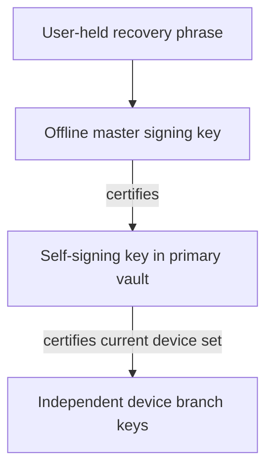

# Root key custody

Design revision 5, phase 1. This proposal changes no executable behavior. The
inspected product baseline is `eae12fbb197f8bbea21b682686c8548fc1a27958`.
Current accounts still keep the root seed on each device. Activation requires
coordinated protocol, verifier, vault, backup and client changes; the guarantees
below describe that future system, not an implemented or audited feature.

## Authority and recovery model

The user keeps one recovery artifact: a generated 24-word recovery phrase. Nodes
store no recovery secret, encrypted recovery capsule, phrase verifier or reset
credential. Normal public identity records and revocation state remain necessary
for authentication; they are not secret recovery storage.

Use three authority tiers:



The master is derived temporarily during setup or an explicit recovery/promotion
ceremony and erased from every device afterward. Only the primary holds the
self-signing private key. Every device holds its own independent branch secrets.
Normal primary operations use the self-signing key, not the offline master.
This adopts the master/self-signing separation from
[Matrix cross-signing](https://spec.matrix.org/latest/client-server-api/#cross-signing);
it does not adopt Matrix secret storage or add a user-signing key.

Lost or stolen primary: enter the phrase on a trusted replacement, certify a new
self-signing key, revoke the old one and retain the same identity. Compromise of
the phrase/master instead requires a new identity and contact re-verification.
A primary's ordinary data-unlock secret, vault credential or branch seed cannot
reconstruct the phrase or master. A backup password restores data, not authority.

If both primary and phrase are lost, identity management is permanently lost.
Surviving secondaries retain local history but stop new authenticated network
operations when their authorization leases expire. They can export data for a new
identity. If only the phrase is lost, the existing primary continues operating,
but cannot replace the offline master or recover from its own future loss; offer
migration to a new identity while it is still available. There is no support reset.

## Verified current implementation

These source facts were checked on the baseline above:

- [Account manifests](../crates/ramflux-sdk/src/bus/protocol.rs) persist
  `root_seed`, `device_seed` and `account_secret`.
  [Daemon startup](../crates/ramflux-sdk/src/bus/daemon.rs) reconstructs the root
  signer from the manifest, so deleting a field alone would break startup.
- [Owned authority](../crates/ramflux-sdk/src/client/identity_authority/owned.rs)
  signs root-bound branch proofs and complete device sets.
  [Registration refresh](../crates/ramflux-sdk/src/client/identity_authority/registration.rs)
  normally renews proofs with a one-hour lifetime. Secondaries currently need the
  root for this refresh even when device membership does not change.
- [Device-set types](../crates/ramflux-protocol/src/identity_keys.rs) preserve
  immutable principal kind and revocation tombstones. Device-set v2 incorporates
  the root-signed [public profile](identity_profiles.md); profile omission and
  downgrade floors already matter. This proposal extends that family to v3.
- [Legacy key backup](../crates/ramflux-sdk/src/bus/dispatch/account.rs) encrypts
  the whole account manifest. The streamed full archive's
  [identity metadata](../crates/ramflux-sdk/src/bus/backup_jobs/format.rs) also
  contains that manifest and a database key. Both currently include the root seed.
- [The recovery KDF](../crates/ramflux-crypto/src/kdf.rs) currently uses Argon2id
  v19 with 262144 KiB, three passes and one lane. That existing password-based
  behavior is not the proposed generated-phrase derivation below.
- Current root access also serves group actor/certificate and profile signing.
  This includes first-contact request/accept/decline signing under
  `ramflux.contact_request.v1` in
  [contact request wire](../crates/ramflux-sdk/src/client/contact_requests/wire.rs).
  Every such accessor needs an explicit authority capability; a missing secret
  must never trigger legacy seed copying or implicit account creation.

The separately developed
[creator snapshot protocol](https://github.com/ramfluxhq/ramflux/blob/0e769262faa869e00f46dfa9d95dd8e76f3d007d/docs/group_state.md)
uses creator authority plus authenticated branch transport. It needs a delegation
verification version before a creator secondary can discard its legacy root.

## Threat model

| Threat | Intended boundary and residual risk |
| --- | --- |
| Stolen/compromised secondary | It can read available history and act as its branch until revocation/lease enforcement. It cannot enroll, revoke, renew its own authority, become primary or recover the identity. A creator delegation can still expose future group traffic to attacker roots; see below. |
| Stolen/compromised primary | The self-signing key can enroll attacker devices and alter primary-authorized state until recovery reaches verifiers. It cannot certify a replacement master or escape its master-certified authority range. Data already read cannot be recovered by revocation. |
| Phrase phishing or capture | The attacker gains master authority. Clipboard history, screenshots, fake support and lookalike prompts are relevant. Unexpected master-authorized replacement is a new-identity incident. |
| Malware during a recovery ceremony | It may capture the temporarily derived master or phrase. The ceremony's OS and trusted UI are part of the trust boundary; routine primary isolation does not stop this attacker. |
| Malicious directory, gateway or relay | It cannot forge authority, approve pairing or decrypt a phrase that is never uploaded. It can withhold records, erasure acknowledgements or renewals and deny service. Signatures alone cannot prove a globally latest head. |
| Rollback, stale backup or old client | Custody-mode latches, one signed-record epoch floor, exact key bindings and revocation tombstones apply before authorization. Restore cannot lower these floors or restore a primary role. |
| Copied legacy root | Erasure cannot remove an attacker's copy. Migration cannot retroactively establish that a historical root was never compromised; an untrusted former holder requires a new identity. |

Every own device records a blocking security alert for a primary-holder or
self-signing-key change, including a revoked old primary on its next public
update. Every new device, first delegation scope, widening of operations and
display-name change creates a persistent non-blocking alert on every own device.
Equivalent branch/delegation renewals are silent and visible in the device/security
log; compare actual permissions, not a newly generated certificate/delegation id.
Show the new device,
kind, capabilities, enrolling primary and delegation scope/expiry. Removal alerts
the removed device: "If this was not you, recover with your phrase on a trusted
device." Alerts identify the account fingerprint, old/new key fingerprints and
whether this device initiated the action, and remain until acknowledged. Offline
or censored devices receive alerts only when they observe authenticated state;
immediate delivery cannot be promised. Contacts distinguish management-key
replacement from an identity-root change.

The app never solicits the phrase in response to a network event, alert, login,
ordinary unlock or support request. Phrase entry exists only inside a locally
user-started recovery/primary-promotion ceremony, including an explicitly started
recovery dry run. Setup explains this rule. A periodic reminder asks whether the
user can still find their phrase; it never opens a phrase-entry form by itself.
Remind at day 1, 7 and 30 after setup, then every 90 days (snoozable). Fixed copy:
"Ramflux will never ask for your recovery phrase outside a recovery or primary
promotion you start yourself. Never share it with support or another person."

## Phrase encoding and deterministic derivation

Generate 32 independent bytes with the operating-system CSPRNG. Encode them using
the English BIP39 wordlist and checksum: 256 entropy bits plus eight checksum bits
form 24 words. Decode back to the original entropy before derivation. This uses
[BIP39's entropy transcription](https://github.com/bitcoin/bips/blob/master/bip-0039.mediawiki),
not its wallet mnemonic-to-seed PBKDF2 function. Reject invalid word counts,
unknown words and checksum failures; never use a user-invented sentence.
Normalize input with Unicode NFKD per BIP39, lowercase English letters and
collapse Unicode whitespace to one ASCII space, trimming ends. Accept only the
English wordlist in v1; a unique four-letter prefix expands to its full English
word before checksum validation. Reject ambiguous/unknown tokens. Never normalize
or alter the decoded 32 entropy bytes.

Proposed profile `ramflux-recovery-v1`:

```text
entropy = decode_checked_24_words(phrase)       # exactly 32 bytes
master_seed = HKDF-SHA256(
    salt = 32 zero bytes,
    IKM = entropy,
    info = UTF8("ramflux.identity.master.v1"),
    L = 32)
master_public_key = Ed25519_public_key(master_seed)
```

The fixed public profile/domain means recovery needs no separate salt file,
capsule or password. [HKDF](https://www.rfc-editor.org/info/rfc5869/) supplies
explicit extract/expand domain separation; it is not a password-hardening scheme.
Generated entropy does not need Argon2id. Reserve a human-passphrase recovery
profile for separate review, including Argon2id parameters, normalization,
minimum-machine measurements and a versioned format. No automatic weaker fallback.
The existing account-data KDF is a separate compatibility concern, not changed
by this design note.

Setup is mandatory for new custody accounts before their first authority record
is published. Show the phrase once in a trusted screen and require the user to
re-enter three distinct, uniformly randomly selected word positions from their
saved copy (selected after the phrase is hidden). Publicly display the
resulting account fingerprint for confirmation. Explicit print/export is allowed;
warn that the exported phrase is identity authority. Export is a user-managed artifact, not
managed runtime state or an application backup; keeping it on the primary makes
a theft of that file a phrase-compromise incident. It never enters normal bus
responses, argv, environment, logs, analytics, crash dumps or sibling sync.

Zeroize entropy, phrase and master buffers on completion, cancellation and error;
avoid secret clones. Do not persist the master in a manifest, database, vault,
wrapped capsule or backup. A new phrase derives a new master: there is no
same-identity "rotate forgotten phrase" operation. Copies of the same user-held
phrase are the same authority, not revocable recovery credentials.

The stage-1 Rust implementation preallocates its normalization, phrase-display
and setup-frame buffers so secret-bearing writes cannot reallocate. Owned buffers
use zeroizing wrappers. Residual library-boundary copies remain: BIP39
`to_entropy_array` returns an entropy array by value before it enters a zeroizing
wrapper; X25519 `StaticSecret::from(*seed)` copies its input seed; HKDF 0.12 retains
an internal PRK that it does not zeroize on drop; and serde_json may allocate a
non-zeroizing deserializer scratch buffer for escaped confirmation words. The
Unicode NFKD `Decompositions` iterator uses a non-zeroizing `TinyVec` buffer, which
can spill to the heap for runs of more than four combining marks. These
copies are bounded and short-lived but are not claimed to be synchronously scrubbed.
Setup replies serialize directly into one fixed zeroizing output buffer.

Release builds use `panic = "abort"`, so a panic does not unwind and cannot run
zeroizing destructors. Keep every phrase, entropy and seed buffer scoped to the
shortest possible ceremony step, disable core dumps and secret-bearing crash
reporting during setup, and do not treat drop-time erasure as protection from a
process snapshot taken while the secret is live.

## One device-set v3 record and one floor

Extend the existing signed device-set/profile family. Device-set v3 carries the
immutable account anchor/kind, public master authorization, primary holder,
self-signing public key, active/recent device roster and revoked-id checkpoint,
branch certificate leases, custody mode, migration status and profile. Its signature is by the
master-certified self-signing key, under a new critical v3 domain. The master
certificate binds that key, account anchor, primary holder, authority scopes and
its permitted record-epoch range. No independent custody record or profile chain.

Profile kind remains immutable. Retain the existing normalized single-line name
rules and verified-kind semantics; neither a profile nor a custodian reference
proves biological humanity. The v3 profile's version is the enclosing record
epoch, including when a device/lease update leaves the visible name unchanged.
The primary alone publishes display-name changes; a secondary queues a request.
The embedded v3 profile is unsigned on its own: only the v3 self-signing
signature authenticates it through the authority chain. It has no nested v1
profile signature. A v2 root signature must not be reinterpreted as a
self-signing signature.
Workflow custody needs an explicitly supported v3 profile rather than silently
reusing v2's legacy workflow behavior.

The [normative proposed wire specification](root_key_custody_wire.md) fixes the
signature domains, JCS bodies, anchor rules, epoch encoding and verification
order. It is a stage-1 review artifact, not an implemented protocol.

New accounts use `identity_root_commitment(master_public_key)` as their immutable
anchor, start in v3 at genesis and never accept v1/v2 sets or legacy branch proofs.
The master signs master certificates only, never legacy sets/profiles/proofs.
Migrated accounts keep `identity_root_commitment(legacy_root_public_key)` and embed
the proposed legacy binding in **every** v3 record. Account fingerprints and
custody contact safety numbers derive from the anchors as specified in the wire
spec; management-key replacement never changes them. Current v1 safety material
also includes device/lineage state, so v3 uses an explicitly versioned stable
anchor comparison and keeps device-change verification state separate. Master
compromise requires a new identity/anchor, not a binding to a new master.

**Epoch ranges (controller-approved policy; wire review pending):**
`epoch = range_index * 2^32 + revision`, with `range_index` in
`[1, 2^21 - 1]` and `revision` in `[1, 2^32 - 1]`; all values remain safe JSON
integers. Each master certificate authorizes exactly one range and one
self-signing key. Pin the first fully authenticated certificate per
`(anchor, range_index)`; any different certificate is equivocation, fences that
range and raises the takeover alert until a higher range is certified. Accept
**any** higher range, not only the next integer. Recovery chooses the maximum
observed range plus one, querying all available trusted checkpoints, and retries
higher on conflict. A primary cannot spend revisions outside its certified range.
Clearing a same-range fence requires an explicit user-started recovery ceremony
with the recovery phrase that certifies a higher range; no primary-only, network,
operator-file-edit or automatic startup action clears it. If the phrase is lost,
the fenced identity cannot resume management and the user must create a new identity.
Migration starts at v3 range 1, independently of legacy epochs: v3 ranks above
all legacy records regardless of their numeric epoch. Exhaustion is a typed
refusal, never wraparound. No globally latest range can be proved against
withholding directories; preserve that limitation in the recovery UI.

Publish against the verified prior record hash/epoch. Stage the exact intent,
require its exact durable acknowledgement and reconcile uncertain results before
claiming success. Same-epoch differing records fail closed. Key rotation,
revocation, lease renewal, profile changes and custody changes all advance the
same record epoch; per-device key epochs still identify branch-key versions.

Every verifier persists a per-account `custody_v3_observed` latch as well as the
record floor: router, gateway/directory, peer SDK, federation and any service
checking device authority. Once latched, reject v1/v2 sets and legacy one-hour
root proofs for that account, even at a larger numeric epoch. A backup import,
cache eviction, server restart or missing optional field cannot clear it. A known
master binding cannot be replaced by another legacy-root endorsement. Unknown
critical formats fail closed. Old peers that only understand v1/v2 cannot contact
a migrated account; rollout/release notes must say so.

The public record includes hashes of its profile, device, delegation, migration,
revocation-id and revoked-checkpoint sections. Conditional fetch by a known head
hash returns `not_modified`; for a changed head, cached unchanged section bodies
are reused. Reconstruct and verify the full logical signed record before accepting
it. Routine renewals never force peers to download unchanged bodies. A response
hash alone grants no authority, and missing/evicted sections must be fetched and
verified rather than silently omitted.

Compaction after 90 days moves old tombstones to a primary-signed cumulative
revoked-device checkpoint (sorted-list hash plus count). The roster cap counts
only active devices and recent tombstones. Verifiers must obtain, stream-verify
and index the committed list: the digest/count alone proves no membership or
absence. All enrolled ids are checked against recent and compacted revocations,
which persist across higher ranges, backups and restart; an old device id is
never reusable. Missing list evidence blocks affected authorization, never means
"not revoked". The wire spec caps the cumulative list at 65,536 ids / 4 MiB of canonical JCS.
Existing verifiers fetch predecessor-linked additions and re-hash locally against
the verified index; first observers fetch the bounded full list. Overflow requires
fresh user-started master re-attestation, never truncation, a cap bypass or denial
reset; if no bounded replacement exists, affected authority changes stay blocked.

For new online operations, refresh verified authority at most five minutes apart;
no older cached fallback after a required refresh fails. Pins dominate cache
freshness. Check current authority per request rather than freezing a device set
for an entire session. Use verifier-local time with ±300 seconds of clock-skew
tolerance and a
persisted monotonic high-water mark of authenticated times to detect rollback;
a directory timestamp alone cannot establish trusted time. Unknown/rollback time
blocks new network authorization and sending, while local history stays readable.
Queued messages accepted while a branch lease was valid remain receivable after
expiry if their branch-signed timestamp is inside the lease plus skew and the
authenticated relay acceptance timestamp independently satisfies that bound.
Backdating alone does not authorize a new send; current revocation still applies.
For a clock rollback, re-establish logical trusted time using fresh authenticated,
challenge-bound samples from at least two independent sources: the own home node
and an independently operated federated node or relay time-probe receipt, agreeing
within ±300 seconds. The second node must have an independent federation/contact
pin or authenticated shipped-bootstrap pin from before recovery started. Freeze
pin provenance in the recovery journal; a home-introduced node in that recovery
is ineligible, including after a restart that merely reuses its learned key.
Different hostnames of one operator do not count twice.
Alternatively the user explicitly confirms the displayed/corrected time with a
visible expiry-risk warning. A journaled new local time generation may replace a
wrongly future time floor; it never lowers identity/mode/epoch/revocation pins.
Ordinary sends remain paused until this succeeds; local history stays readable.
No clock alert requests the recovery phrase. See the wire spec for exact checks,
time-source authentication, reset audit state and proxy deployment assumptions.
Withholding newer signed state remains a first-observer limitation.

## Primary vault and typed signer

The primary stores only its self-signing key, behind a non-synchronizing vault
provider. Secondary manifests contain public authority references and branch/data
secrets. No secondary credential can unwrap a primary key. Require typed signer
methods for enrollment, revocation, profile publication and delegation; no generic
sign-arbitrary-bytes bus API. Public identity lookup must work without a signer.

| Vault strength class | Policy |
| --- | --- |
| Hardware-wrapped, access-controlled local vault | Preferred when the platform/provider supports it; independent provider review is required. Do not claim native nonexportable Ed25519 support merely because hardware protects a wrapping key. |
| Software OS credential vault | Explicitly show the weaker isolation boundary. Same-user process compromise and provider access rules remain relevant. Disable synchronization and portable secret export. |
| TUI encrypted file vault | Initial proposal requires a generated local unlock secret with at least 128 bits of entropy and a reviewed authenticated format/HKDF wrapping profile. Store the generated unlock secret exclusively in a non-synchronizing OS credential keychain. A 0600 plaintext file is not a fallback; if no supported keychain is available, primary signing is unavailable on that installation. No plaintext fallback or entropy claim based only on password length. Human-chosen vault passphrases need a separately reviewed memory-hard profile. |

The local vault credential is for routine unlock, not another artifact needed to
recover identity. Never substitute the recovery phrase as that credential or
cache it for unattended signing. Losing any primary vault class is handled by
phrase recovery and self-signing-key replacement. Suspected exposure during a
phrase ceremony instead follows the master-compromise/new-identity rule. Show
vault class, current primary and key fingerprints on the security screen.

Expire unlocked signer handles, zeroize temporary private material, and avoid
secret-bearing diagnostics. OS compromise can still steal the running primary's
management key or data. A signed software claim cannot prove physical erasure or
prove that a vault provider is hardware-backed.

## Operations and secondary leases

| Operation | Required authority |
| --- | --- |
| Initial master/self-signing setup | Phrase-derived master, explicit human ceremony |
| Replacement primary or self-signing key | Phrase-derived master certifies a fresh key/range; old authority revoked |
| Device add, branch rotation, revocation, lease renewal, signed-set publish | Primary self-signing key and exact current record |
| Contact request, accept or decline (v2 consent) | Primary self-signing key; a secondary queues the exact intent for primary approval |
| Public display-name change | Primary self-signing key; secondary request remains pending |
| Issue/revoke account-level own-group scope or private group restriction | Primary self-signing key within master-certified scopes |
| Register, renew session proof, resume | Device branch + unexpired certificate + current v3 device set |
| Prekeys, messages, receipts, calls and transport envelopes | Branch keys, current authority and existing operation permissions |
| Own-device history/contact sync; data backup | Branch authentication and data keys; no authority secret |
| Creator snapshot/request result or group genesis | Current creator branch with its seven-day `create_and_administer_own_groups` grant; creator anchor and any encrypted group restriction checked |
| Group ownership transfer | Primary authority plus the existing fresh-head/transferee acceptance rules |
| Non-creator group change request | Requesting branch plus current group role |
| Recover data into a secondary | Fresh local branch, sanitized data, then primary approval before networking |

Primary-issued branch certificates bind account, device/key epochs, signing and
agreement key commitments, immutable kind and capabilities for at most 30 days.
The complete current set provides revocation. A branch proves possession for each
short session challenge using its own key, a fresh nonce, certificate hash,
audience and session/transport binding. Refresh/retry uses a fresh proof id; it
never needs the master or a primary round-trip while the lease remains valid.
Registration v3 is required across gateway, router, SDK and federation.

Contact consent v2 replaces the private-root signature in
`ramflux.contact_request.v1` with a self-signing signature, tied to the actor
anchor, exact sending branch, v3 record hash and current master certificate (wire
spec). A delayed consent remains valid through unrelated same-range revisions
if its referenced historical record authenticates, its self-signing key is unchanged,
its sending branch/key epoch is still active with current authority, and its seven-day
TTL, time and replay checks pass. A higher range/key replacement or revocation
requires a new approval. Directories serve superseded records by hash for the TTL
plus skew; the initial migration record and last legacy head are retained forever.
A secondary can transport a primary-approved exact intent but cannot mint
it. All request/accept/decline kinds follow this rule. Never reinterpret v1's
`actor_root` as a self-signing key or let a secondary fetch the legacy root.
Legacy accounts keep v1 until migration; custody accounts require peers with v2
consent capability. Otherwise show "this contact needs to update" and keep the
intent pending, without a downgraded v1 signature.

Expired devices can read local history but cannot send, register, resume or mint
new authenticated operations. Servers and peers enforce this, not just UI. Warn
the secondary and managing primary seven days before branch-lease expiry. The
primary can batch renewals; expiry never activates a legacy proof fallback. A
travelling user may explicitly promote a secondary with the phrase, thereby
replacing/revoking the old primary. Preserve agreement identities and data keys
through migration; do not regenerate existing prekeys from a different authority
seed. Root-qualified identity types and the existing CI identity check still apply.

## Pairing and approval

Use Matrix-style SAS with committed X25519 exchange, HKDF and explicit key
confirmation, built from reviewed implementations. A candidate is
[vodozemac SAS](https://docs.rs/vodozemac/latest/vodozemac/sas/index.html);
its [published audit](https://matrix.org/media/Least%20Authority%20-%20Matrix%20vodozemac%20Final%20Audit%20Report.pdf)
covers specific earlier revisions, not automatically a new dependency version or
this application's transcript. Pin and review the implementation/audit delta.
Do not invent a PAKE or adopt an unaudited SPAKE2 implementation.

1. The user starts pairing on the primary. Create a one-use five-minute invitation
   with a fresh random identifier. Deliver the invitation by QR or typed rendezvous
   identifier over the existing device-pair session path
   (`client/routed/session.rs` and `client/routed/pair_lifecycle.rs`), with a
   restricted pre-enrollment bootstrap for SAS frames only; this is planned integration, not an existing
   root-free enrollment endpoint. Relay transport is untrusted until SAS finishes.
   Public handshake input is size/rate bounded;
   it cannot create an enrollment request or an unsolicited approval prompt.
2. The secondary generates branch keys locally. Bind the committed handshake to
   both ephemeral/public branch keys, account/master fingerprints, invitation,
   current authority epoch, principal kind, requested role, purpose and suites.
   Reject all-zero/invalid agreement input, reflection, suite downgrade and replay.
3. Both trusted screens compare seven emoji with accessible descriptions, giving
   42 SAS bits as in the
   [Matrix emoji method](https://spec.matrix.org/latest/client-server-api/#sas-method-emoji).
   The TUI displays those same seven emoji as their standard English Matrix
   names, in order; no decimal alternative or new SAS encoding. Fixed copy:
   "Only compare with a device you are holding; never read these symbols to anyone."
4. Require both local human confirmations and independent MAC key confirmations.
   Only then send the signed enrollment proposal inside the confirmed channel.
   Display the exact new device, root, kind, capabilities and expiry using safe
   text rendering. A changed proposal or authority head requires revalidation.
5. The primary explicitly approves those keys and publishes the v3 set. Release
   usable branch authority/start sync only after its exact durable ACK. Retries
   reuse the proposal id; no duplicate enrollment or seed-copy fallback.
6. The secondary verifies the account fingerprint, certificate, exact key/set
   inclusion and transcript. Erase invitation/ephemeral secrets on every exit.

A user-reported mismatch immediately cancels the invitation, erases ephemeral
state and raises a warning; never retry the same invitation after a mismatch.
Allow at most three transport/protocol failures per invitation, then invalidate it; limit
concurrent invitations and creation rate on the primary. Propose three live
invitations and ten creations per hour, with bounded unauthenticated frame queues.
Limits protect availability and approval fatigue; a relay cannot grant approval.
A matching short code is a human authentication check, not an AEAD password.

## Replacement and recovery

For planned primary transfer, generate the new self-signing key and fresh branch
on the destination, and enter the phrase only in its user-started promotion flow.
Authenticate both devices and the recipient's ephemeral HPKE key through SAS.
Use [RFC 9180 HPKE](https://www.rfc-editor.org/rfc/rfc9180.html) mode Auth
(`0x02`): DHKEM(X25519, HKDF-SHA256) (`0x0020`), HKDF-SHA256 (`0x0001`),
AES-256-GCM (`0x0002`). The old primary's transfer-only X25519 sender key and the
recipient's X25519 HPKE key are both bound by the confirmed SAS transcript and
old-primary branch proof. Auth proves possession of that bound sender key;
Base mode without a signed sender binding would allow anyone to encrypt a forged
handover. The wire spec fixes `info`, `aad`, the 1 MiB payload and replay journal.
Use one Seal/Open at sequence zero, then destroy the context. Require RFC 9180
suite vectors and application binding vectors before implementation acceptance.
The payload carries pending invitations/journal, delegation state, an encrypted
summary of every known group restriction/revocation (including old-primary floors
from earlier ranges), pending erasure
state and explicitly selected optional data keys; no phrase, master, self-signing
secret or vault unlock credential travels. The destination creates its certificate
locally. HPKE does not itself approve enrollment or prevent replay.

Publish the master-certified replacement and exact v3 record before activation.
Then erase/demote or revoke the old primary; expose incomplete cooperative cleanup.
The new certificate's range fences the old signer even if it retained a copy.
Use a crash journal and reconcile uncertain ACKs; never revive the old authority
from a stale file. Reset outbound sessions/sender chains as needed without
rewinding historical receive state.

After loss/theft, fetch signed public authority and surviving-device checkpoints,
verify retained floors and explicitly confirm the account fingerprint. The new
primary creates a fresh self-signing key and branch. Default to revoking every
other device; retaining a trusted survivor requires explicit key verification and
fresh possession proof, not copying the potentially compromised directory list.
Publish the higher master-authorized range and alert all observing devices. Keep
the same phrase/master: replacing the stolen management key does not require a
new identity. If the phrase was exposed, create a new identity instead.
After an uncommanded master-authorized replacement, steer to "new identity, keep
history" rather than offering repeated counter-recovery: a thief with the phrase
can alternate replacements forever. Any counter-recovery is an explicit expert
action with that warning, never the default.

If all trusted checkpoints are lost, disclose that a directory may withhold newer
signed records. Do not promise global freshness or silently overwrite a conflict.
Recovery derivation needs no memory-hard KDF; nevertheless benchmark the complete
flow, including vault, registration and account-data initialization, on the
minimum supported machine. No "low-memory" shortcut may weaken legacy data KDFs.

## Legacy migration and erasure

Migration is opt-in for existing accounts and mandatory-default for new accounts
after the coordinated rollout. Upgrade every verifier and both backup paths first.

**Open compatibility decision:** an existing random root seed cannot simply be
turned into the specified HKDF-derived master while retaining its old public key.
The proposed same-identity migration uses one legacy-root-signed public binding
from the existing account anchor to the new phrase-derived master, included in
normal v3 authority metadata. After accepting it, verifiers pin that master;
the legacy root can never authorize a second binding or replace the new master.
This adds no recovery secret/capsule on a node, but phrase-only legacy restoration
needs availability of the normal public binding. Confirm this policy before
implementation. If even that public-metadata dependency is unacceptable, legacy
migration requires a new identity with retained local history. Do not disguise
this choice by skipping HKDF or retaining the old secret in a backup.

For this proposed path, **only after owner approval**:

1. Confirm the saved phrase and primary vault, freeze legacy writers, independently
   verify the existing device keys and profile, and stage the exact v3 transition.
2. Publish it and receive its exact durable ACK before sending irreversible erase
   commands. The v3 mode floor rejects further legacy proofs at every verifier.
3. The primary erases its superseded legacy seed after publication and uses only
   its self-signing key. Provision public branch certificates and creator
   delegations before a secondary erases. Keep its branch/data keys; remove root/self-signing material
   from manifests, DB/WAL, staging and signer caches. Restart without a legacy
   signer and send a branch-signed ACK bound to migration id, signed record hash
   and device epoch through a narrow, quota-protected migration endpoint.
4. Batch ACKs into the next signed v3 set. Until published, show those devices as
   pending rather than falsely complete. A crash resumes erasure/reconciliation,
   never the old root-enabled runtime.
5. Pending/unreachable devices have a signed 30-day deadline and cannot use normal
   custody sessions without erasure ACK. At the deadline their migration authority
   expires; revocation is the default, published by the primary on reconciliation.
   Later return requires explicit fresh enrollment, not silent reactivation.

Before a trusted re-attestation has resolved the binding, two different
authenticated legacy bindings for one anchor mark the account `identity_compromised`, alert every observing own device/contact safety view and
refuse both bindings. Never choose by arrival order or lowest hash. Resume only
after a higher-range master re-attestation to the chosen binding under the
already trusted master; a fresh verifier with no trusted master must independently
reverify it out of band. A signature by an arbitrary competing master cannot
resolve which identity was intended. After a trusted-master re-attestation resolves
the conflict, permanently pin that master and the chosen binding hash. Later
competing legacy bindings are ignored for authority and logged as security events;
they cannot suspend that verifier again or force repeated phrase ceremonies.
New observers without this resolved pin remain first-observer limited. See the
wire verification algorithm. Test loss of the primary before and after publication,
rejected/uncertain
publish results and partially received ACK batches. The phrase can recover the
new management authority only once the corresponding public transition exists.
Erasure ACKs are honest-client statements, not remote attestation. Inventory old
backups/snapshots and warn that a copied legacy root cannot be made secret again.
Use a new identity if any former root holder cannot be trusted.

## Full backup and restore

The current streamed and legacy key backups both need a custody-aware logical
sanitizer before activation. Full backups must never contain master entropy,
master/self-signing seeds, a recovery capsule, primary vault contents or an
ordinary-backup-decryptable wrapper for authority. This applies on primaries and
secondaries alike, even if the outer archive itself is encrypted.

Add an authenticated `contains_legacy_root_seed` header flag and show it before
restoration. Older archives lacking the flag are potentially root-bearing; an
unauthenticated header is not proof of safety. Decrypt/classify inside a trusted
migration/sanitization flow before importing. Never import root material into a
secondary or headless process. Retained legacy root-bearing archives need an
explicit warning even after live-device erasure.

Preserve history, complete attachments and existing unavailable-attachment policy.
Sanitize logical manifests, DB/WAL rows, configuration, staging, diagnostics and
vault references; an encrypted DB plus its ordinary database key is not itself
a custody boundary. Keep streamed authentication, verify-then-commit, encrypted
staging, cancellation cleanup, newer-wins merge, tombstones and monotonic floors.
Saved primary roles and authority records cannot overwrite newer live authority.

A data restore uses a fresh local branch and requires primary approval before
networking. Recovery/promotion is a separate, user-started phrase operation.
Old outbound ratchets remain inactive; new sessions and sender chains precede
sending. Data backups do not restore the phrase, and phrase recovery alone does
not recover history for which the user has no surviving data keys/backup.

## Creator secondary signing

Each verified own secondary receives exactly one seven-day account-level
`create_and_administer_own_groups` scope, auto-issued at enrollment and renewed
without adding group-specific entries to the public identity record. Its allowed
operations are genesis, snapshots and request results. Group verifiers check the
account anchor against the group's actual creator anchor and current group role.
No public group ids, genesis hashes, group counts or per-group delegation-id index.
The grant count scales with secondaries, not groups × secondaries.

Any narrower group-specific delegation/restriction and its revocation travel only
inside that group's authenticated encrypted control channel. They cannot widen
or outlive the current account grant as positive authority. Old-primary signed
restrictions and revocations remain binding denial floors across range changes
and grant expiry until the current primary explicitly replaces them, referencing
the old control hash. Retained historical certificates authenticate these floors
without granting old keys current powers. A delegate cannot remove a restriction
from group state to regain broader permissions. Handover lists the floors; absent
private evidence blocks affected group mutations until reconciliation. No subdelegation.
Ownership transfer remains primary-only and retains the existing fresh creator-head check, transferee
countersign and sticky removals. A new group wire version verifies the account
chain and encrypted restrictions, independent source authentication, complete-state
hashing and role/budget/conflict rules. Other roots still request changes rather
than gaining cross-root creator authority.

A compromised delegate can add attacker roots, disclose future group traffic,
remove members, change roles and rename within its authority window. This is an
explicit residual risk of offline creator availability. A foreign-root addition
by a delegated own device creates an alert on the primary when observed; an
attacker withholding all evidence cannot be promised to self-report. Ownership
transfer, device revocation/key rotation and management-key replacement fence old
delegations. The primary revokes the account-level grant in v3 state; a narrower
per-group revocation stays in the encrypted group control state. Routine equivalent grant
renewals go to the security log; new scope or widening raises the device alert.

Expired delegation cannot authorize a newly received mutation merely by backdating
its claimed issue time. Previously pinned history remains readable. A fresh
receiver/catch-up after expiry needs renewed current authority; primary absence
beyond seven days can therefore block creator mutations until renewal. Warn before
that expiry (proposed one day), separately from the seven-day warning on 30-day
device leases. No raw-root or legacy-signature fallback for custody accounts.

Advertise `custody_v3`, `contact_consent_v2` and `group_delegation_v1` in authenticated
device manifests and federation capability negotiation. Old nodes cannot verify
v3 and must refuse it with an update-required result; federation never strips
binding/certificates or converts it to legacy. In mixed-version groups, a legacy
creator uses the current primary/root signing path when any member cannot verify
delegation. A custody creator needs the custody-aware group wire even for direct
primary signing; if any member lacks it, block the mutation and show the update
requirement. Do not drop old members or silently create a fork to proceed.
Legacy accounts in stage 2b retain existing one-hour proofs, signatures and group
behaviour; 30-day certificates apply only once an account enters custody mode.

## Headless identities and user experience

`headless_ai` is never primary, a phrase-entry target or a master/self-signing-secret
consumer. Bot/workflow custody uses the same restriction. Reference a separate
verified human custodian account/root-qualified device in an explicit external
custody variant; it is not a human device inside the service's immutable-kind set.
The service self-signing key lives in that human-operated vault. Service branches
receive only branch/data secrets and scoped certificates. Do not accept a role
flag, restored manifest or self-asserted human kind as custody authority.

Each service has independent user-held recovery entropy. The human account's
phrase does not derive service masters. A custodian with N service identities
therefore manages N + 1 independent phrases. Explain that burden during service
creation and allow explicit per-service print/export, or storage of agent phrases
in the human custodian's own vault with an explicit local compromise warning.
Agent processes and nodes still receive none of them. Such optional user-managed
vault storage does not turn routine full backups into authority backups.
Custodian renewal can be batched with explicit scope; show expiry reminders and a clear waiting state when the human
is unavailable. A daemon cannot promote itself to avoid lease expiry.

Replacing or losing that human primary also requires N service re-certifications,
even for a planned transfer: service self-signing secrets never travel, and each
service master certifies a fresh key bound to the new human device. The human
phrase alone cannot do this. Old device references/leases may stop service writes
until each agent completes the step; explain the N-agent cost and warn on expiry.

Provide a custodian-driven "re-certify my services" batch journal: enumerate the
verified managed service anchors and old/new custodian devices, show per-agent
expiry, generate each fresh service self-signing key in the new human vault, and
request each agent phrase locally from its own operator or explicitly unlocked
user-managed vault. Derive each master only inside that local ceremony, sign its
higher-range certificate, erase temporary master/phrase buffers, then publish and
verify the exact service ACK before marking that item complete. Only public
certificates/records travel; neither agent phrases nor self-signing secrets are
sent between devices or to nodes. Pause/resume is per agent and idempotent after
crash/uncertain ACK; an unavailable phrase leaves that agent waiting, not silently
rebound to the human master. Fresh same-root branch recertification and revocation
of old service authority follow each new range. Service daemons cannot bypass it.

The client always signs the hash of its own TLS exporter into the branch proof.
With direct TLS/QUIC termination the verifier compares its own exporter hash.
Behind a TLS-terminating proxy, that proxy must be operated by the receiving node
and use a dedicated node-authorized proxy key published in the signed node record.
It observes the client-facing exporter itself and countersigns a receipt containing
its hash; the verifier requires equality with the proof binding, exact proof hash,
nonce and audience. A receipt that merely repeats signed proof fields is insufficient.
Proxy keys rotate through the signed node record with overlap and historical key
retention; current compromise revocations dominate unconsumed evidence. A sender
relay or forwarded header cannot establish channel evidence. Deployments unable
to provide this require explicit, off-by-default `no_channel_binding` in the node
record and separate client opt-in, with visible status and a persistent client
security-log entry per connection. The client still supplies its own exporter hash,
but this mode lacks verified channel binding; no failure silently enables it.
The wire spec defines the exact fields, key roles and planned negative vectors.

Desktop security shows account fingerprint, primary/custodian, vault class,
verified devices, pending erasures, phrase setup, branch/delegation expiry and
security alerts. Pairing shows exact permissions only after channel confirmation.
Recovery distinguishes recovering authority from restoring data and confirms the
fingerprint before publication. Offer user-started recovery dry runs and "new
identity keeping my local history", with contacts requiring re-verification.

TUI provides the same ceremonies and seven standard emoji names, safe delimited
text and interactive hidden secret entry. Never accept
phrases in shell arguments, environment or unattended confirmation flags. Routine
unlock and automatic reminders never ask for the phrase. State loss/recovery and
incomplete migration plainly rather than silently creating another account.

## Staged implementation and acceptance

1. Freeze v3 authority/profile, master certification, epoch-range policy, branch
   certificates/session proofs, section fetch/checkpoint, node receipt/time and
   group delegation formats. Decide legacy public binding semantics, review SAS/HPKE implementations and vault classes, and
   publish cross-client vectors. Stage 1 exits only after independent approval
   of both this design and `root_key_custody_wire.md`, owner disposition of the
   legacy-binding proposal, reviewed epoch-range encoding, the pinned SAS provider/audit delta, vault providers
   and full-flow minimum-machine benchmark plan. Reviewed golden wire vectors
   must be published before stage 2b begins. No account activates custody yet.
2. **2a: public identity and typed signer separation.** Preserve current wire and
   legacy storage while removing implicit root access from ordinary SDK startup,
   owned identity lookup and non-root operations. Test the abstraction separately;
   this stage alone does not authorize erasure. Produce a complete reviewed
   appendix inventorying every private-root use: registration, gateway auth,
   contact request/accept/decline, group actor certificates/genesis/snapshots,
   profile, device namespace, backups, manifest import/export and all additional
   accessors found by the source audit, with each replacement signer/path.
3. **2b: registration v3 and verifiers.** Implement certificate plus branch proof
   across router, gateway, directory, SDK and federation. Enforce current authority,
   all mode/epoch floors, immutable profiles, leases, replay and exact ACKs before
   enabling writers. Entry requires approved wire spec and published vectors
   from stage 1 plus the reviewed 2a root-use inventory. Prove keyless registration
   beyond one hour and resume. Legacy accounts remain unchanged until migration.
4. Add vaults, SAS approval, replacement/recovery journals, mandatory phrase setup
   and both backup sanitizers/header classification. Fail closed on unavailable
   providers. No migration before the whole secret path is covered.
5. Add delegated group genesis/snapshots/results and seven-day renewal/revocation.
   Provision actor/delegation certificates before erasing creator secondaries.
6. Ship desktop/TUI and external service custody, then opt-in legacy migration and
   new-account custody default. Explain old-client incompatibility and old-backup
   risk. Controller-run realnet gates precede enabling the default.

Required native/property/security tests:

- BIP39 entropy/checksum and HKDF/Ed25519 golden vectors across clients; no wallet
  seed derivation, invalid phrase/length/domain, cancellation and zeroization.
- No master/self-signing secret in secondary files, manifests, DB/WAL, exports,
  logs, API output or headless provisioning. Vault failure has no plaintext path.
- New anchors refuse legacy records from genesis; migrated anchors always carry
  binding; conflicting bindings mark compromise and require trusted re-attestation.
- Master recovery defeats poisoned primary revisions, accepts skipped ranges and
  migrates despite a maximal legacy epoch. Wrong ranges, forged certificates,
  same-range certificate equivocation, same-epoch record conflicts, profile
  downgrade/omission/kind swaps and restart/restore floor rollback fail closed.
- Keyless proof renewal after one hour, fresh retry ids, resume, per-request
  revocation, stale/foreign authority, replay across accounts/sessions/transports,
  expired leases, ±300-second boundaries, authenticated queued delivery,
  unknown/rollback time, two independent fresh samples, user-confirmed reset,
  poisoned fast-clock recovery and readable offline history while sending is blocked.
- Contact v2 self-signing signatures, all consent kinds, historical-head lookup,
  same-range delayed delivery after renewal, changed-key/range/revocation refusal,
  TTL+skew retention, pending intents and legacy-only peer/federation downgrade.
- SAS commitment, key substitution, reflection, wrong root/kind/purpose, suite
  downgrade, comparison/MAC failure, attempt budgets, approval spam, modified
  proposal, concurrent enrollment and uncertain publication ACK.
- HPKE vectors and transcript/AAD/recipient substitution, replay, truncation,
  cancellation and crashes at every recovery/transfer boundary; old primary is
  fenced; device/new-scope/widening/name and primary changes alert, equivalent
  renewals are log-only, removed devices alert, and no phishing phrase prompt appears.
- Minimum-memory complete recovery on supported hardware, TUI/desktop parity,
  three-word setup, normalization/checksum/prefix rejection, reminders at day
  1/7/30/90, dry runs, expiry warnings and new-identity history migration.
- Concurrent migration, primary loss mid-migration, ACK batching, malformed ACKs,
  node-withheld ACK/renewal, pending deadline/revocation and old clients facing v3.
- Streamed/full/key backup root-header classification, missing flags, sanitized
  legacy import, primary/secondary restore, attachment completeness, deletions,
  inactive outbound state and no ordinary-backup primary promotion.
- Creator secondary creates and mutates while primary is offline; a compromised
  delegate adds a foreign root and triggers the primary alert, then revocation,
  expiry, key rotation and transfer reject later writes. Same-epoch concurrency,
  sticky removals, large epoch gaps and bounded delivery remain covered.
- Section hash reconstruction, head not-modified, missing/evicted sections and
  no unchanged-body download on renewal; public records contain no group metadata.
- Aged tombstone compaction preserves full-list membership/absence and supersets;
  missing evidence, restart and restore cannot reactivate a compacted device id.
- Resolved binding/master pins cannot be suspended by later legacy-root bindings.
- Node receipt-key rotation/overlap, historical keys, compromise revocation and
  TLS proxy proof/receipt substitution fail closed.
- N-agent re-certification after planned/lost primary, per-agent pause/resume,
  missing phrase and expiry; no service authority secret crosses devices.
- Service custodian references must be verified human identities; bot/workflow/
  headless devices cannot become primary through API, restore or kind spoofing.

Reserve realnet slices `custody01_pairing_and_primary_offline`,
`custody02_primary_loss_same_identity`, `custody03_legacy_erasure_and_downgrade`,
`custody04_creator_delegation` and `custody05_backup_and_service_custody`.
Run them with existing identity/proof-renewal, sibling restore, group convergence,
agent, call and full-backup slices. These are implementation acceptance plans;
phase 1 supplies only this design and its review report.

Revision 5 keeps the legacy public binding **pending owner confirmation**. Channel
binding, bounded revocation deltas, pre-recovery time pins and inherited private
group floors above are design requirements; their future vectors do not imply
implemented or audited custody support.

## Local born-v3 implementation boundary

Experimental born-v3 creation is available only with the explicit default-off
`LocalBusConfig.enable_born_v3_creation` option, exposed by
`rf daemon start --enable-born-v3-creation`. Existing `account.create` requests,
legacy manifests and legacy registration/session behavior keep their v1/v2 flow.
This stage creates local authority only: its typed result is `NetworkingPending`.
It does not attempt registration, publish to a node or open a session. Born-v3
accounts receive a typed `NetworkingPending` error on the legacy gateway path;
there is no root-proof fallback. V3 live registration is a separate implementation
boundary, including channel-bound branch proofs and authenticated node/proxy keys.

Trusted local frontends use the SDK's exclusive `CustodyBusClient` connection:

1. `account.custody.begin` validates public setup intent and returns the anchor.
2. `account.custody.show_once` returns one zeroizing display buffer. This uses the
   dedicated `ramflux.local_bus.custody.v1` reply protocol, never an ordinary bus
   response, event, actor command or idempotency/retry journal. The ordinary
   `LocalBusClient` refuses these reserved methods.
3. After hiding and erasing that display buffer, call
   `account.custody.hidden_challenge`. Only then are three distinct word positions
   chosen uniformly from 1–24.
4. `account.custody.confirm` accepts one three-word attempt in challenge order.
   A wrong answer cancels the entire ceremony without per-word feedback.
   `account.custody.cancel`, a disconnect before confirmation starts, expiry or any
   setup error also destroys pending phrase state. Once accepted confirmation has
   started its blocking vault/persistence job, a client disconnect does not cancel
   the durable commit. Ceremonies expire after five minutes of monotonic time.

The trusted frontend must keep the display out of logs, shell history, ordinary
bus diagnostics, analytics and crash reporting. It owns and erases the returned
`Zeroizing<String>` and the confirmation-word buffers. There is no CLI phrase
printing flow or user interface in this stage. Secret transport buffers and
queued inbound setup values erase on drop, including cancellation. No phrase,
entropy or master is stored in an account manifest, database, keychain or backup.
Setup request identifiers are limited to 128 bytes before any secret-bearing body
is processed, and the complete secret frame is limited to 4096 bytes.

The native primary provider currently supports macOS's protected OS credential
keychain with synchronization explicitly disabled for reads and writes, and
When-Unlocked/This-Device-Only access control on inserted credentials. It is
software credential custody, not nonexportable hardware Ed25519 isolation.
The host must run in a user context and carry provisioning-authorized keychain
access entitlements; a plain unprovisioned CLI build is not sufficient. See
[Apple's keychain implementation requirements](https://developer.apple.com/documentation/technotes/tn3137-on-mac-keychains).
The bus checks provider availability before generating or showing a phrase;
a missing entitlement or unavailable vault returns `CustodyVaultUnavailable`.
No signing or provisioning configuration is changed by enabling the creation option.
Other platforms refuse primary creation until an appropriate provider is implemented;
there is no plaintext file fallback. Primary self-signing authority and branch
credentials occupy separate vault references, independent of data unlock secrets.
Provider and local persistence failures never silently select a weaker vault.

Public authority and the signed publication record are retained in
`custody_accounts/<local_account_id>/authority.json`, together with the immutable
born-v3 mode latch and authenticated head/certificate/revocation pins. Public
reads do not unlock the primary signer. The account index arbitrates concurrent
legacy/new creation. Custody uses an insert-only index reservation and rechecks
the legacy manifest immediately before public authority persistence; it never
replaces a row won by concurrent legacy creation. A startup marker with neither
an index reservation nor public authority is an interrupted pre-reservation step
and is removed with a typed operator-visible reason so the id can be retried.
Failed writes or vault operations after reservation keep the id blocked for
reconciliation rather than retrying it as a legacy account. An existing reservation
continues to reject legacy sessions even when its public authority file is incomplete.
Primary credentials and this reserved setup state are not exported through legacy
account/data backup APIs.
The local signed record is ready for a later publication implementation; its
presence is not evidence of remote acceptance, account networking or live custody
rollout. The proposed legacy public binding remains pending owner confirmation.

### Local daemon ownership and pin updates

A daemon takes an exclusive, nonblocking OS lock on `daemon.lock` in its data root
before reconciling markers or replacing a socket. The inode is never unlinked.
Different socket paths do not permit two daemons to own one data root. A detached
custody-confirm worker retains this lease until its vault and durable publication
work completes, including after disconnect or daemon shutdown.

Startup quarantines inconsistent custody markers per account, with a structured
`custody_marker_inconsistent` reason; invalid names use `custody_marker_invalid_name`.
These entries do not stop unrelated accounts. A corrupt authority remains fenced
from legacy creation/unlock, and account listing reports an incomplete pending
account with `CustodySetupInvalid`. A marker with neither an index row nor public
authority can be removed only while holding the data-root lease.

New legacy bus creation uses the same insert-only account-index reservation as
custody. Replace-capable library and restore callers retain their compatibility
semantics; custody still checks manifest and reservation ownership at publication.

The SDK stores only pin hashes and floors in local `authority.json`. Any future
local head advance must call `observe_with_previous` with the separately stored,
accepted `record`, rather than `observe`, so a valid conflict can retain its
same-range evidence. Old accepted-record cache copies are pruned before conflict
pairs; at most the newest eight fenced ranges are retained within the total 4 MiB budget.
A current-range master-certificate conflict is checked before revision rollback.
Superseded ranges remain ordinary rollback rejections.
